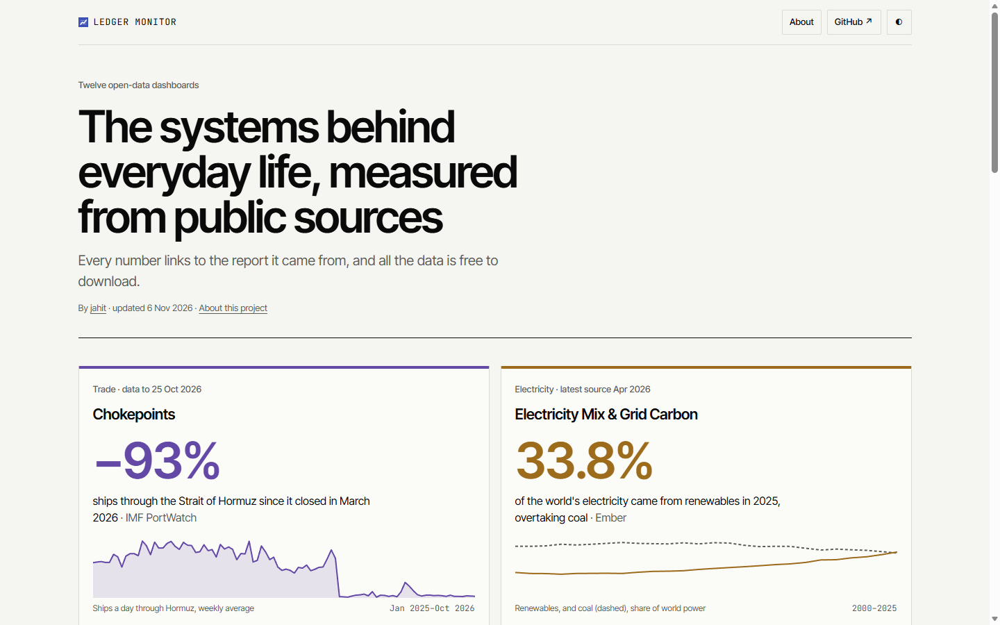

# Ledger Monitor

<p align="center">
  <strong>Nineteen open-data dashboards on the systems behind everyday life.</strong> Every number links to the report it came from, and all the data is free to download.
</p>

<p align="center">
  <a href="https://github.com/jahitjanberk/ledger-monitor/stargazers"></a>
  <a href="LICENSE"></a>
  <a href="DATA_LICENSE.md"></a>
  <a href="https://github.com/jahitjanberk/ledger-monitor/commits/main"></a>
  
  
</p>

<p align="center">
  <a href="https://jahitjanberk.github.io/ledger-monitor/"></a>
</p>

<p align="center">
  <a href="https://jahitjanberk.github.io/ledger-monitor/chokepoints/"></a>
  <a href="https://jahitjanberk.github.io/ledger-monitor/electricity/"></a>
  <a href="https://jahitjanberk.github.io/ledger-monitor/air/"></a>
  <a href="https://jahitjanberk.github.io/ledger-monitor/housing/"></a>
</p>

<p align="center">
  <a href="https://jahitjanberk.github.io/ledger-monitor/water/"></a>
  <a href="https://jahitjanberk.github.io/ledger-monitor/scams/"></a>
  <a href="https://jahitjanberk.github.io/ledger-monitor/internet/"></a>
  <a href="https://jahitjanberk.github.io/ledger-monitor/orbit/"></a>
</p>

<p align="center">
  <a href="https://jahitjanberk.github.io/ledger-monitor/food/"></a>
  <a href="https://jahitjanberk.github.io/ledger-monitor/debt/"></a>
  <a href="https://jahitjanberk.github.io/ledger-monitor/heat/"></a>
  <a href="https://jahitjanberk.github.io/ledger-monitor/minerals/"></a>
</p>

<p align="center">
  <a href="https://jahitjanberk.github.io/ledger-monitor/medicines/"></a>
  <a href="https://jahitjanberk.github.io/ledger-monitor/energy/"></a>
  <a href="https://jahitjanberk.github.io/ledger-monitor/vaccines/"></a>
  <a href="https://jahitjanberk.github.io/ledger-monitor/fertilizer/"></a>
  <a href="https://jahitjanberk.github.io/ledger-monitor/remittances/"></a>
  <a href="https://jahitjanberk.github.io/ledger-monitor/disasters/"></a>
  <a href="https://jahitjanberk.github.io/ledger-monitor/wages/"></a>
</p>

<p align="center">
  <a href="https://github.com/jahitjanberk/ledger-monitor/tree/main/data"></a>
  <a href="https://github.com/jahitjanberk/ledger-monitor/archive/refs/heads/main.zip"></a>
  <a href="#running-it-locally"></a>
</p>

<p align="center">
  <a href="METHODOLOGY.md">Methodology</a> · <a href="DATA_LICENSE.md">Data licence</a> · <a href="CONTRIBUTING.md">Contributing</a> · <a href="about/">About</a>
</p>

<p align="center">
  <a href="https://jahitjanberk.github.io/ledger-monitor/"></a>
</p>

| Dashboard | What it shows |
|---|---|
| [Chokepoints](chokepoints/) | Ships and oil through the world's narrow sea routes, and what the 2026 closure of the Strait of Hormuz did to them |
| [Electricity Mix & Grid Carbon](electricity/) | What 195 countries make their electricity from, and how much carbon each kilowatt-hour carries |
| [The Air We Breathe](air/) | Fine-particle pollution in every country against the WHO guideline, and the deaths linked to it |
| [Housing Affordability](housing/) | What homes cost against what households earn, in 96 major markets |
| [Water Stress](water/) | How much of their renewable freshwater countries withdraw, and who lacks safe drinking water |
| [The Scam Economy](scams/) | Money lost to scams, as reported to national agencies and estimated by surveys |
| [Where the Internet Lives](internet/) | Submarine cables, cloud regions, AI compute, and the power and water data centres use |
| [Who Owns Orbit](orbit/) | Who launches objects into space, and what is up there now |
| [Food Prices & Hunger](food/) | Who goes hungry, who can afford a healthy diet, and how fast food prices are rising, country by country |
| [Debt vs Public Services](debt/) | What governments pay in interest on their debts, against what they spend on health and education |
| [Floods, Disasters & Insurance Gaps](disasters/) | Who lives with flood risk, what disasters kill and cost, how much of the loss is insured, and England's flood risk |
| [Extreme Heat](heat/) | How hot the world is getting, which countries face the most dangerous heat, and what it costs in lives and work |
| [Critical Minerals](minerals/) | Where the minerals in batteries, phones and power grids are mined and refined, and who controls them |
| [Medicine Shortages & Supply](medicines/) | Which medicines run short and for how long, why, and where the world's medicines and their ingredients are made |
| [Household Energy Prices & Poverty](energy/) | Who still lacks electricity or clean cooking, what European households pay, and who can't afford to keep warm |
| [Fertiliser Prices & Supply](fertilizer/) | What fertiliser costs, who makes and exports it, which countries depend on imports, and how the 2026 Hormuz closure fed through to farmers |
| [The Cost of Sending Money Home](remittances/) | How much migrants send home, how much it matters to each economy, and what it costs to send by route and by type of provider |
| [Wages & the Cost of Living](wages/) | Minimum and average wages by country, pay after inflation, working poverty, labour's share of income, and what a healthy diet costs against the minimum wage |
| [Vaccination & Health Workers](vaccines/) | How many children are vaccinated or get no vaccines at all, where measles is spreading, and where nurses and doctors are scarce |

## Across the dashboards

- **[Country profiles](country/)**: one page per country (240 of them) with its figures from every dashboard, each cited and ranked against other countries. For example [Kenya](country/ken/) or the [United Kingdom](country/gbr/).
- **[Compare](compare/)**: up to four countries side by side. The choice is kept in the address, so a link like [`compare/?c=KEN,IND,BRA`](compare/?c=KEN,IND,BRA) can be shared.
- **Search** on the hub finds dashboards, countries, minerals and sea routes.
- **[Embed a chart](embed/)**: any dashboard's headline chart in an iframe on your own site, drawn from the published data and naming its source.
- **[Updates feed](feed.xml)**: an Atom feed of new dashboards and data refreshes.

## Running it locally

The site is plain HTML, CSS and JavaScript with no build step. Serve the folder with any static web server, or use the included one (Node.js 18 or later):

```sh
node scripts/serve.mjs
```

Then open http://localhost:8765/. Opening the HTML files directly from disk won't work, because browsers block the dashboards' scripts and data on `file://` pages.

## Regenerating the pages

The country pages, compare data, search index and feed are generated from `data/`. After changing any data, run:

```sh
node scripts/hub-sparks.mjs && node scripts/countries.mjs && node scripts/preload-hints.mjs && node scripts/seo.mjs
node scripts/feed.mjs        # after adding an entry to docs/updates.json
node scripts/freshness.mjs   # which sources are due for a new edition
node scripts/check.mjs       # loads every page in a headless browser and reports problems (Node.js 22+)
```

On GitHub, [`check.yml`](.github/workflows/check.yml) runs the page check on every pull request and push to `main`, and [`freshness.yml`](.github/workflows/freshness.yml) runs the freshness check every Monday and fails when a source is overdue.

## The data

Each dashboard's tables are in `data/<dashboard>/` as CSV and JSON, with a `sources.json` listing every publisher, and a data page that links to them. [METHODOLOGY.md](METHODOLOGY.md) explains how each dashboard's figures are made and what they leave out. Every dashboard's tables can be rebuilt from fresh downloads with the scripts in [scripts/build/](scripts/build/README.md).

## Licences

- **Code:** MIT, see [LICENSE](LICENSE).
- **Data:** our compilation is CC BY 4.0. Some underlying data has stricter terms, notably TeleGeography's cable data, which is non-commercial. See [DATA_LICENSE.md](DATA_LICENSE.md).

## Contributing

Corrections with a link to a better source are very welcome. See [CONTRIBUTING.md](CONTRIBUTING.md).

Made by [jahit](https://github.com/jahitjanberk). More on the [About page](about/).
